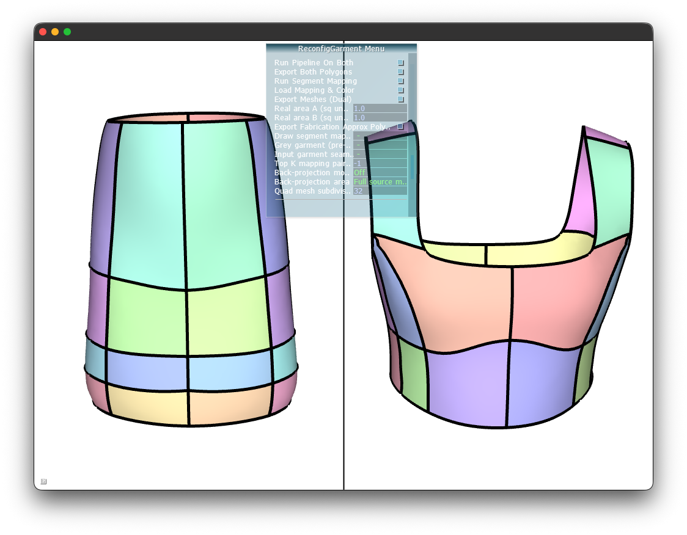

# ReconfigGarment

ReconfigGarment shows two garments side by side and maps segments between them. It is built on top of [parafashion](https://github.com/nicopietroni/parafashion). This folder is the set of files you add to a parafashion installation. It does not contain `lib/`. Those libraries come from parafashion, and files under `lib/` are left unchanged.



After the copy below, the parafashion directory builds only `reconfiggarment`.

## Requirements

- CMake 3.1 or newer
- A C++14 compiler
- Qt 5 (Widgets, OpenGL, Svg)
- GLUT / FreeGLUT
- Python 3, with the `python` command on `PATH`

On Debian-based systems:

```bash
sudo apt install build-essential cmake qt5-default libqt5svg5-dev freeglut3-dev
```

On macOS, install Qt 5 (Homebrew `qt@5`), plus OpenGL and GLUT. This build uses Qt at `/opt/homebrew/opt/qt@5` and the Command Line Tools SDK `MacOSX26.5.sdk`. It is built and tested on macOS with Apple silicon.

## 1. Install parafashion

```bash
git clone --recursive https://github.com/nicopietroni/parafashion.git
cd parafashion
git submodule update --init --recursive
```

That checkout supplies `lib/` (vcglib, libigl, garment-flattening, AntTweakBar, glew, json, Directional, xfield_tracer, Clipper). Do not copy `lib/` out of it, and do not edit those libraries.

## 2. Copy reconfiggarment into that checkout

From this `reconfiggarment` folder, with `PARA` set to the parafashion checkout:

```bash
export PARA=/path/to/parafashion

cp CMakeLists.txt "$PARA/CMakeLists.txt"
cp apps/reconfiggarment.cpp "$PARA/apps/"

cp include/experiment_settings.h "$PARA/include/"
cp include/garment_session.h "$PARA/include/"
cp include/manual_border_seam.h "$PARA/include/"
cp include/patchgraph.h "$PARA/include/"
cp include/reconfiggarment_widget.h "$PARA/include/"
cp include/segment_processor.h "$PARA/include/"
cp include/uv_back_projection.h "$PARA/include/"
cp include/parafashion.h "$PARA/include/parafashion.h"
cp include/parametrizer.h "$PARA/include/parametrizer.h"

cp src/experiment_settings.cpp "$PARA/src/"
cp src/garment_session.cpp "$PARA/src/"
cp src/manual_border_seam.cpp "$PARA/src/"
cp src/reconfiggarment_widget.cpp "$PARA/src/"
cp src/myglwidget.cpp "$PARA/src/myglwidget.cpp"
```

Three of those files already exist in parafashion and are overwritten because this program needs the edited versions:

| File | What to do |
| --- | --- |
| `include/parafashion.h` | Replace the parafashion copy |
| `include/parametrizer.h` | Replace the parafashion copy |
| `src/myglwidget.cpp` | Replace the parafashion copy |

`src/moc_glwidget.cpp` is already in the parafashion tree. Leave it in place.

The segment-mapping button starts `segmentMappingSolver/run_mapping_solver.py` and looks for a project root that contains `CMakeLists.txt`, `src/`, and `segmentMappingSolver/`. Copy the solver into the parafashion checkout under that name and install its Python packages:

```bash
cp -R /path/to/MappingSolver "$PARA/segmentMappingSolver"
cd "$PARA/segmentMappingSolver"
pip install -r requirements.txt
```

The solver also needs the external `turning_function` module on `PYTHONPATH`. The app launches the script with `python`.

## 3. Build

```bash
cd "$PARA"
mkdir -p build
cd build
cmake ..
cmake --build . --target reconfiggarment -j
```

The executable is `build/reconfiggarment`.

## 4. Run an experiment

Saved experiments live in `exp/<name>/` inside the parafashion directory. Each folder holds `config.json` and the two garment meshes.

From `build/`, pass the folder name:

```bash
./reconfiggarment --experiment longskirt_lululemon_2
```

You can also pass a path to the experiment folder. The window opens with both garments loaded from that experiment.

The menu has four actions, in the order you use them:

1. **Run Pipeline On Both** — run the pattern pipeline on both garments.
2. **Export Both Polygons** — write each garment's segment polygons (`_polygons.txt`).
3. **Run Segment Mapping** — call MappingSolver to match segments between the two garments.
4. **Export Fabrication Approx Poly** — write the fitted fabrication polygons for that mapping.

To start from two meshes instead of a saved experiment:

```bash
./reconfiggarment <garment_mesh_1> <garment_mesh_2>
```

You can also run the solver on polygon exports directly:

```bash
cd "$PARA/segmentMappingSolver"
python run_mapping_solver.py garment1_polygons.txt garment2_polygons.txt output_mapping.txt
```

It writes `output_mapping.txt` (segment pairs, scores, and rigid transforms) and `output_mapping_quads.txt` (fitted approximate polygons).

| Variable | Default | Description |
| --- | --- | --- |
| `PARAFASHION_QUAD_WORKERS` | auto | Parallel workers for polygon fitting |
| `PARAFASHION_QUAD_BACKEND` | `process` | `process`, `thread`, or `serial` |
| `PARAFASHION_APPROX_VERTICES` | `4,5` | Candidate vertex counts for the approximate fit |
